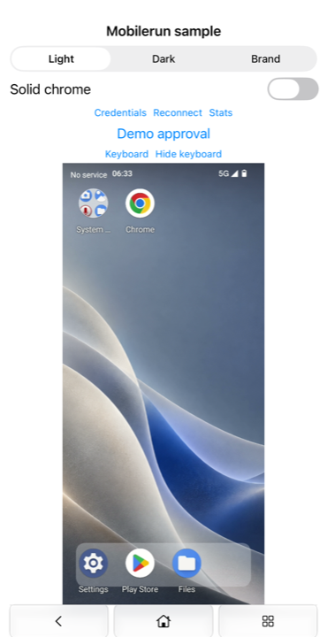

<p align="center">
  <picture>
    <source media="(prefers-color-scheme: dark)" srcset="assets/mobilerun-dark.png" />
    <source media="(prefers-color-scheme: light)" srcset="assets/mobilerun.png" />
    
  </picture>
</p>

<h1 align="center">mobilerun-swift</h1>

<p align="center">
  <strong>Swift components for embedding Mobilerun device streams in your iOS app.</strong><br />
  Live WebRTC video, remote input and task approvals with customizable SwiftUI controls.
</p>

<div align="center">

<a href="https://docs.mobilerun.ai/partners">🤝 Partner guide</a>
·
<a href="https://docs.mobilerun.ai">📕 Documentation</a>
·
<a href="https://cloud.mobilerun.ai">☁️ Mobilerun Cloud</a>


[](LICENSE)
[](https://discord.gg/ZZbKEZZkwK)

[React](https://github.com/droidrun/mobilerun-react) · [Android](https://github.com/droidrun/mobilerun-android) · **iOS** · [Flutter](https://github.com/droidrun/mobilerun-flutter)

</div>

> **Building Mobilerun phones into your platform?** Start with the [Partner guide](https://docs.mobilerun.ai/partners). It walks through the API key, one phone per user, stream keys and live viewing step by step.

<table>
<tr>
<td width="280" valign="top">

</td>
<td valign="top">
<strong>In this package</strong>
<ul>
<li><code>DeviceStreamSession</code> — owns connection, recovery and controls.</li>
<li><code>StreamCredentials</code> — binds a stream URL to a fresh-key provider.</li>
<li><code>DeviceStream</code> — SwiftUI stream with default controls and overlays.</li>
<li><code>DeviceStreamView</code> / <code>DeviceStreamUIView</code> — video and input for custom UI.</li>
<li><code>DeviceStreamHandle</code> — keyboard and system-key actions for SwiftUI.</li>
<li><code>StreamTheme</code>, <code>StreamLabels</code>, <code>StreamSlots</code> — customize default UI.</li>
<li><code>TaskApprovalModel</code> / <code>TaskApprovalCard</code> — approval state and UI.</li>
<li><code>StreamStats</code> — read-only connection and video statistics.</li>
</ul>
<strong>Requirements</strong>
<ul>
<li>iOS 15+ for streaming.</li>
<li>Swift 6.2 and Xcode 26 or newer.</li>
<li>A Mobilerun API key on your server.</li>
</ul>
</td>
</tr>
</table>

macOS supports transport-independent tests only. `MobilerunStream` is the only library
product; the protocol target is an implementation detail.

## Microphone and camera

Pass the device's backend-provided `publishCapabilities` in `StreamConfig` to enable the floating
microphone/camera pill. Use `session.startPublish(PublishOptions(audio: true, video: true))`,
`await session.stopPublish()` and `session.$publishState` for custom controls. Add the required iOS
privacy usage descriptions; capture begins only after the device accepts an explicit start. The server authorizes every
request. See [publishing](docs/publishing.md) for setup, errors and lifecycle behavior.

## Install

Pre-release Swift SDK: nothing is published yet; install from source with SwiftPM:

```swift
.package(url: "https://github.com/droidrun/mobilerun-swift", branch: "main")
```

In Xcode, add the repository's `main` branch in Package Dependencies and select
`MobilerunStream`. See the [connection guide](docs/stream-keys.md) for the future tagged form.

## Quick start

1. Your Node.js server mints a short-lived stream key for one device with
   `client.streamTokens.create`; follow the [Partner guide](https://docs.mobilerun.ai/partners).
2. Your app's `tokenProvider` asks your server for a key before each connection.
3. The SDK opens the stream with that key, one key per connection, and reconnects with a fresh one.

On your server, use `@mobilerun/sdk` 6.3.0 with `MOBILERUN_API_KEY` in the server environment:

```sh
npm install @mobilerun/sdk@6.3.0
```

```js
import { MobilerunSDK } from '@mobilerun/sdk';

const client = new MobilerunSDK({
  apiKey: process.env.MOBILERUN_API_KEY,
  logLevel: 'off',
});
// iOS: omit origins. For browsers, use a server-approved array of exact origins.
const allowedOrigins = undefined;
// Authenticate your user and authorize access to deviceId before minting.
const result = await client.streamTokens.create(
  { deviceId, ttlSeconds: 120, allowedOrigins },
  { maxRetries: 0 },
);
// result is { key, keyId, expiresAt }. Return result.key through your authenticated endpoint.
// Never log or cache the key. Keep MOBILERUN_API_KEY on the server.
```

To revoke a token on the server, call `await client.streamTokens.delete(result.keyId)`.

Raw REST fallback: `POST /v1/identity/stream-keys` accepts the same request fields.

In your app, supply your backend's stream URL and key calls:

```swift
import MobilerunStream
let session = DeviceStreamSession(credentials: {
    guard let url = try await backend.streamURL(deviceID) else { return nil }
    return StreamCredentials(url: url, tokenProvider: {
        try await backend.mintStreamKey(deviceID)
    })
})
session.start() // In the main-actor session owner.
DeviceStream(session: session) // In your SwiftUI view.
```

Keep the session across view remounts and call `session.close()` on owner teardown.
Keep your API key on the server; recreate the session when switching devices.

A stream key works for one connection. The SDK calls `tokenProvider` before every connect
attempt, including each reconnect, and never reuses a key. If the provider throws or takes
longer than 10 seconds, the attempt fails with `credentials_unavailable` and the normal backoff applies.

`tokenProvider` is the recommended form. The static `StreamCredentials(url:token:)` form is
**legacy and deprecated** until the legacy token hard cut, and is an explicit exception to the
no-reuse rule: it keeps working and **a reconnect reuses the same token**. That only suits tokens
that stay valid; single-use stream keys need the provider. The SDK logs one warning per session
that uses a static token. If both are given, `tokenProvider` wins.

### Errors

```swift
session.onError = { error in
    // error.reason, error.message, error.attempt, error.final
}
// Or read session.lastError from SwiftUI; it clears once the stream connects.
```

| `reason` | Meaning |
| --- | --- |
| `credentials_unavailable` | The provider threw, timed out or returned a blank key. |
| `connection_refused` | The socket closed or failed before opening: wrong device, refused origin (403), 404, network. |
| `token_rejected` | The upgrade answered 401: a used, expired or revoked key. |
| `disconnected` | An open session dropped, including the server's 30-minute session cap. |
| `device_unavailable` | The server explicitly reported the device offline or not ready; not inferred from timeouts or statuses. |
| `unknown` | Anything else, including a missing configuration after the socket opened. |

`final` is `true` when the SDK stops retrying; the default UI then shows its Retry button.

### Labels

Every string the default UI renders comes from `StreamLabels`, with English defaults:

```swift
DeviceStream(session: session)
    .streamLabels(StreamLabels(connecting: "Verbinde…", disconnected: "Getrennt",
                               unavailable: "Gerät nicht erreichbar", retry: "Erneut versuchen"))
```

## Guides

| Guide | Covers |
| --- | --- |
| [Stream keys and connection](docs/stream-keys.md) | Credentials, retries, timeouts, transport, audio and WebRTC compatibility. |
| [Video and input](docs/video-and-input.md) | SwiftUI/UIKit views, touch, keyboard, clipboard and display-only mode. |
| [Default UI](docs/default-ui.md) | Themes, labels, slots, white-label controls and Liquid Glass. |
| [Lifecycle](docs/lifecycle.md) | Visibility, foreground recovery and network transitions. |
| [Task approvals](docs/task-approvals.md) | Polling, subscriptions, decisions, countdown and adaptive cards. |
| [Statistics and benchmark](docs/stats.md) | Sampling, measurements and the simulator benchmark. |

## Contributing

See [CONTRIBUTING.md](CONTRIBUTING.md) for builds, tests, conformance fixtures, the example app and releases.
Report vulnerabilities privately using [SECURITY.md](SECURITY.md).

## License

Apache-2.0; see [LICENSE](LICENSE).
